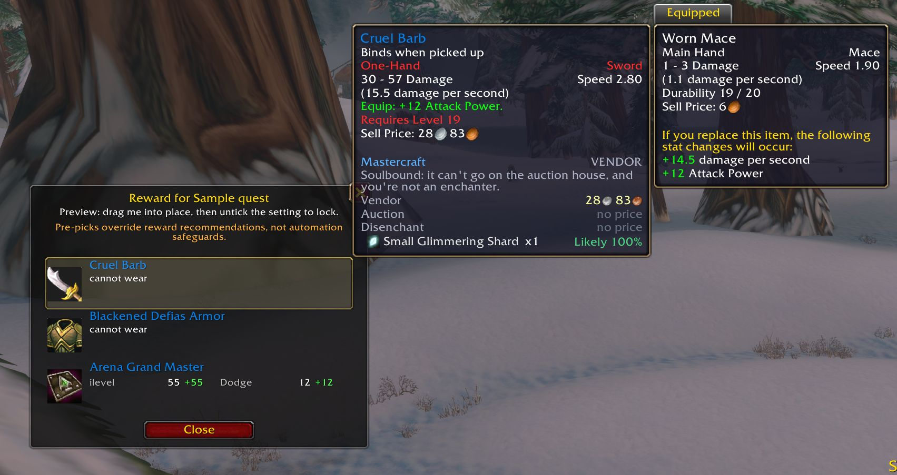
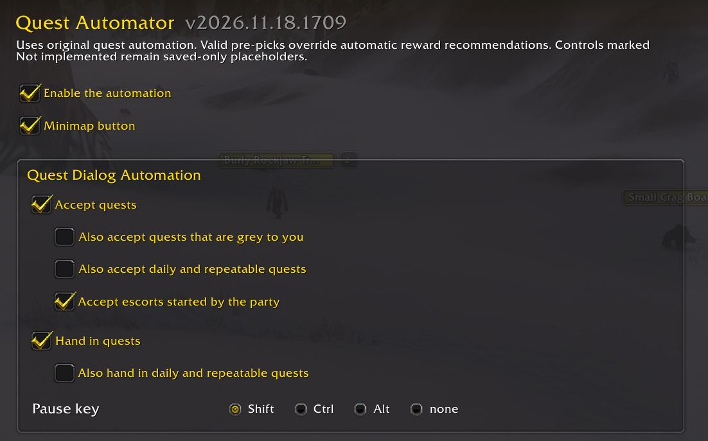

# QuestAutomator

**Automatic quest acceptance, turn-ins, and reward selection for World of Warcraft.**
Talk to a quest giver and let QuestAutomator handle the dialogs. Choose rewards ahead of time
with the pre-picker, or let the addon select for your character or for vendor value.

For **WoW Forever** and **Classic Era / Anniversary / Hardcore**.

## Getting started

1. Install the `QuestAutomator` folder in your client's `Interface/AddOns` directory.
2. Open **Esc → Options → AddOns → Quest Automator**, or type **`/qam settings`**.
3. Enable quest acceptance and turn-ins, and choose how rewards should be selected.

**Minimap button:** left-click toggles the pre-picker; right-click opens settings.
Hold **Shift** (configurable) while talking to an NPC to handle that conversation manually.

## Features

- **Quest dialogs:** automatically accept quests and hand in completed ones, including quests with no reward choice.
- **Reward selection:** choose best fit, highest vendor value, or manual selection. Configure weapon,
  trinket, and quality restrictions, plus vendor-value fallback when nothing fits.
- **Pre-pick rewards:** browse quests in your log, compare rewards with equipped items, and save a choice
  for each quest before returning to the NPC.
- **Minimap overview:** hover to see quests with reward choices and the status of your pre-picks.
- **Manual control:** pause automation or exclude particular NPCs and quests.
- **Experience overlay:** optionally show the experience available from completed quests awaiting turn-in.

Quests that are **grey to your character**, repeatable quests, and PvP-flagging quests are skipped by
default. Quests that require money to turn in are left to you.

## Pre-picking a reward

Open the picker with `/qam pick` or the minimap button. Select a quest, hover its rewards to inspect
them, and click the item you want. Click your selected item again to clear that choice.

A valid pre-pick takes precedence over automatic reward recommendations at hand-in. It does **not**
override disabled automation, pause, ignore lists, or turn-in safeguards. If the saved item is no
longer offered, the configured reward-selection rules apply. Selections are cleared when the quest
is handed in or abandoned.

Use **Unlock and show the pick window** in settings to preview the panel with sample items and move it.

## Commands

| Command | Action |
|---|---|
| `/qam settings` | Open settings |
| `/qam pick [questID]` | Open the reward picker |
| `/qam on` / `/qam off` | Enable or disable automation |
| `/qam pause` / `/qam resume` | Pause or resume for this session |
| `/qam reward fit\|value\|manual` | Choose the automatic reward policy |
| `/qam ignore npc` / `/qam ignore quest` | Toggle an NPC or quest exclusion |
| `/qam why` | Explain the reward recommendation on screen |
| `/qam help` | List all commands |

`/questautomator` is an alias for `/qam`. For troubleshooting, use `/qam status`, `/qam log 20`, and `/qam debug`.

## Settings

[Reward selection](Assets/QuestAutomator_Screenshot_Settings_RewardSelection.jpg) ·
[Pre-picker and feedback](Assets/QuestAutomator_Screenshot_Settings_PrePickFeedback.jpg) ·
[Reward tiers](Assets/QuestAutomator_Screenshot_Settings_RewardTiers.jpg) ·
[Wearable and valuable](Assets/QuestAutomator_Screenshot_Settings_RewardWearibility.jpg)

**Current limitations:** controls marked **Not implemented — no effect** only save their values;
they do not affect automation. The NPC reward glow and `/qam why` recommendation do not yet reflect
saved pre-picks. Additional tooltip information in screenshots may come from other addons.

## Credits and license

Based on **Smart Quest Automation** by [qqytqqyt](https://github.com/qqytqqyt/SmartQuestAutomation).
QuestAutomator changes © Kuro. The source distribution does not include a license; the original
author's rights remain reserved.